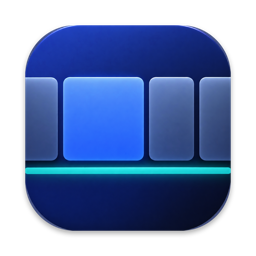

<p align="center">
  
</p>

<h1 align="center">Ultrawrail</h1>

<p align="center">
  A scrolling window manager for macOS, built for ultrawide monitors.<br>
  Your windows sit in columns on a horizontal strip; the screen is a viewport that slides along it.
</p>

<p align="center">
  <a href="https://github.com/juansuarezdev/ultrawrail/actions/workflows/ci.yml"></a>
  
  
  <a href="LICENSE"></a>
</p>

<!-- Screenshot: docs/images/hero.png -->

## Why

On a 34" or 49" ultrawide, tiling everything into fixed halves wastes the width and shrinks your windows. Ultrawrail keeps each window at a comfortable size, lays them out side by side on an endless strip, and scrolls the strip as you move focus. Nothing is resized behind your back when you open a new window.

## Features

- **Scrolling columns.** Windows live in columns on a horizontal strip. Focus a column and the strip scrolls to it. Columns can hold a vertical stack.
- **Ultrawide aware.** Maximum column width, centered or minimal focus scrolling, and an optional centered strip.
- **Pages.** Several strips per display; switch pages like virtual desktops, and move windows between them.
- **Zones.** Split a display into vertical zones, each with its own pages.
- **Templates.** A visual panel (`Ctrl+Alt+T`) to reflow the current page into a layout by dragging windows into slots. Built-in templates, plus your own from the editor in Settings.
- **Excluded apps.** Keep chosen apps out of the strip.
- **Menu-bar app.** No Dock icon. Settings for motion, gaps, widths, templates, pages and shortcuts.
- **Keyboard first.** Global hotkeys for everything, with a legend for Windows or Mac keyboards.

<!-- GIF: docs/images/scroll.gif, docs/images/templates.gif -->

## Shortcuts

Written for a Windows keyboard on a Mac (`Win` = `⌘`, `Alt` = `⌥`, `Ctrl` = `⌃`). Every one can be rebound in Settings → Atajos (with conflict detection and reset), and shown in Mac notation instead.

| Shortcut | Action |
| --- | --- |
| `Ctrl+Alt+←/→` or `H/L` | Focus left / right |
| `Ctrl+Alt+↑/↓` or `K/J` | Focus up / down within a stack |
| `Ctrl+Alt+Shift+←/→` or `H/L` | Move the column left / right |
| `Ctrl+Alt+R` | Cycle column width |
| `Ctrl+Alt+F` | Column full screen |
| `Ctrl+Alt+C` | Center the column |
| `Ctrl+Alt+[` / `]` | Stack into / pull out of the left column |
| `Ctrl+Alt+A` | Adopt the focused window into the strip |
| `Ctrl+Alt+T` | Template panel |
| `Win+Alt+←/→` | Previous / next page |
| `Win+Alt+Shift+←/→` | Move the window to the previous / next page |
| `Ctrl+Alt+Win+←/→` | Previous / next zone |
| `Ctrl+Alt+Win+Shift+←/→` | Move the window to the previous / next zone |

> `Win+Alt+←/→` can be shadowed by menu shortcuts in some apps (Chrome, Brave, VS Code, iTerm). macOS does not report that conflict.

## Install

There are no prebuilt binaries yet: the app is not notarized. Build it yourself.

Requirements: macOS 13+, Xcode command line tools (Swift 6.0+).

```sh
git clone https://github.com/juansuarezdev/ultrawrail.git
cd ultrawrail
scripts/bundle.sh          # builds build/Ultrawrail.app
open build/Ultrawrail.app
```

To keep the Accessibility permission across rebuilds, sign with a stable identity:

```sh
SIGN_IDENTITY="Apple Development: Your Name (TEAMID)" scripts/bundle.sh
```

### Accessibility permission

Ultrawrail moves other apps' windows through the Accessibility API. On first launch, grant it in **System Settings → Privacy & Security → Accessibility**. If you rebuild unsigned and the grant is lost: `tccutil reset Accessibility dev.ultrawrail.app`.

## Development

```sh
swift build
swift test
```

The layout logic is pure and lives in `Sources/LayoutEngine`; `UltrawrailCore` holds the controller (zones, pages, focus) behind protocols; `UltrawrailApp` is the AppKit/Accessibility/Carbon shell.

Manual checks that need a real Accessibility grant are listed in [docs/smoke-test.md](docs/smoke-test.md).

## Status and limitations

Early and personal-use grade. Known rough edges: a column that overflows its zone can overlap the neighbouring zone, shrinking a zone flattens stacks, and empty pages accumulate when moving forward.

## License

[MIT](LICENSE)
